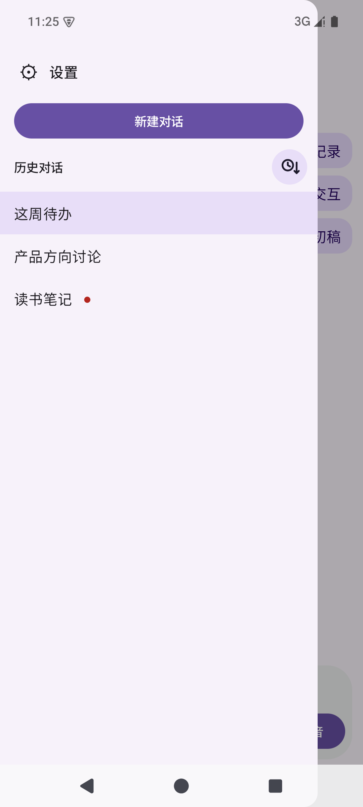
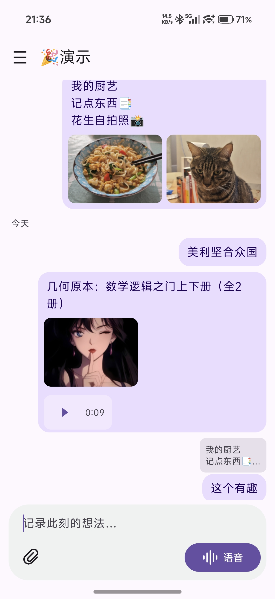
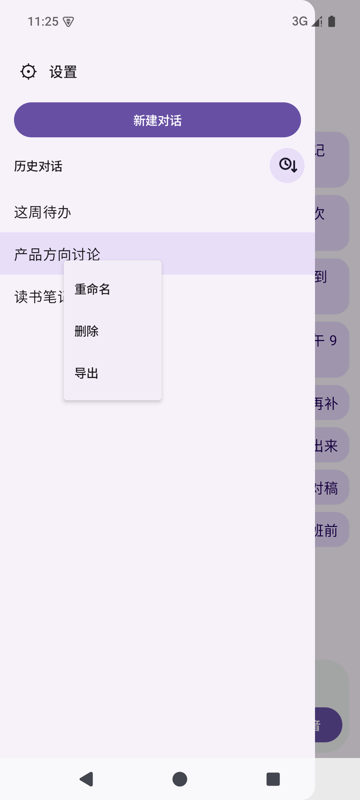
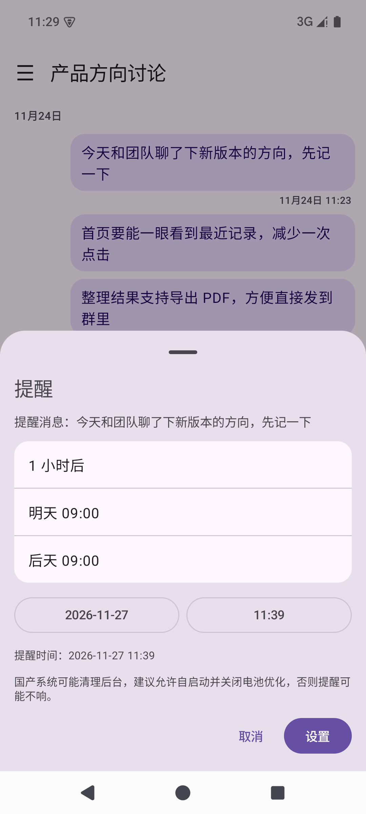

# 聊天笔记（Chat Notebook）

本地优先的 Android 对话记录与整理应用。日常对话保存在用户自己选择的本地文档目录中，不依赖云端账号，也不需要联网：记录、整理、提醒与导出全部在本机完成。

[开源仓库](https://github.com/itangwentian/chat-notebook) · MIT License · Android 8.0（API 26）及以上

设计目标是：数据归用户所有，全程本地处理、不接入任何外部服务，整理结果可读、可导出、可追溯。

## 界面预览

| 对话列表 | 聊天记录 |
| :---: | :---: |
|  |  |
| 多会话列表，红点提示存在新的整理结果 | 长按消息可引用、编辑、设置提醒或删除 |

| 长按对话 | 整理结果 |
| :---: | :---: |
|  |  |
| 重命名、删除、导出 | 进入即整理，可查看并导出 MD / PDF / PNG |

| 提醒设置 | |
| :---: | :---: |
|  | 长按消息即可为这条记录设置提醒，提供“1 小时后”“明天 09:00”等快捷时段，也可自定义日期时间，时分滚轮首尾循环 |

## 核心功能

### 对话记录

- 多会话聊天，支持新建、重命名、排序与删除对话。
- 消息支持编辑并保留历史版本、引用回复、表情回应、批量多选、复制、删除与合并。
- 合并消息按分段保留各自的字体与颜色格式，原消息仍可追溯。
- 多选后可转发到其他对话，或通过系统选择器发送到微信、QQ 等已安装应用。
- 返回层级：只有对话界面按返回退出应用并回到桌面，设置、整理结果及其内部表单与法律文档逐级返回。
- 列表位于底部时打开输入框，会自动把最后一条消息推到输入框上方完整显示；手动上滑调整位置后不会被强制拉回。

### 图片与语音附件

- 图片、语音保存在记录目录的 `attachments/` 下，通过 `.nomedia` 标记避免进入系统相册。
- 删除对话时只清理无人引用的附件；单条消息软删除后附件引用仍然有效。
- 图片预览支持保存到系统相册（`Pictures/ChatNotebook`）和转发到已安装应用。

### 对话整理

- 整理完全在本地完成，由本地代码按消息内容生成文档，不发起网络请求。
- 在对话列表长按菜单中选择“导出”，进入结果页时立即执行一次整理；完成后可查看、重新整理并导出，列表以未读红点提示新结果。
- 整理结果绑定消息内容版本，进程中断遗留的任务会标记失败并允许重试。
- 文档结构为 `# 对话名` → `## 年M月d日` → `『HH:mm』正文`，不显示“用户/助手/系统”角色标签，并保留粗体、斜体、删除线与颜色。
- 整理结果页按文字与图片分块渲染，图片内联在对应时间点，点击图片可查看原图。
- 支持导出 Markdown、PDF、PNG：Markdown 以 base64 内嵌图片，PDF 自动分页绘制，PNG 超出高度上限时提示改用 PDF 或 Markdown。

### 局域网同步

- 两台设备在同一局域网内扫描二维码直接配对，二维码携带对端地址与端口，不依赖 mDNS 发现；成功后互信无到期时间，重启或切换记录目录仍然有效。
- 两端打开应用时自动交换新增与变更的对话、删除标记和缺失附件。
- 初次同步保留双方已有笔记，并发编辑保留主版与冲突副本。
- 设置页可暂停、继续、移除设备，并查看最近一次成功同步时间。

### 隐私与安全

- 应用不接入任何外部服务，不收集记录内容，也不保存任何服务凭据。
- 设置页只包含局域网同步与法律文档入口；局域网同步使用一次性二维码配对，数据仅在局域网内传输。
- 从旧版本升级时会清理历史遗留的服务配置、凭据与同步设置，旧记录文件仍可正常读取。

### 本地存储

- 记录长期保存在用户选定的本地目录，卸载应用不会删除；重装后重新选择目录即可恢复。
- 每个对话一个 `session-<id>-<代数>.json`，写入顺序为“新文件写入并核验 → 更新 Room”，损坏可回退旧代数。
- 首次打开旧版快照目录会自动拆分迁移，成功后再删除旧文件。
- 文件为 UTF-8 JSON，带代数与 SHA-256 校验；Room 仅作可重建的查询缓存。

## 技术栈

Kotlin 原生 Android、Jetpack Compose、Material 3、轻量 ViewModel + Repository、Coroutines/Flow、Room、Kotlin Serialization，使用 Gradle Kotlin DSL 构建。Gradle Wrapper 8.10.2、Android Gradle Plugin 8.8.2、Kotlin 2.1.21；编译 SDK 35，最低 SDK 26。需求与变更由 OpenSpec 管理。

## 构建与运行

需要 Android SDK（`ANDROID_HOME` 指向 SDK，或在未纳管的 `local.properties` 中设置 `sdk.dir`）与 JDK 17 或更高版本：

```powershell
.\gradlew.bat assembleDebug
.\gradlew.bat testDebugUnitTest
.\gradlew.bat lintDebug
```

APK 生成在 `app/build/outputs/apk/debug/app-debug.apk`，可直接安装到 Android 8.0（API 26）及以上设备。

使用模拟器验证：

```powershell
emulator -avd chat_notebook_api35 -gpu host
adb wait-for-device
.\gradlew.bat :app:installDebug
adb shell am start -n com.chatnotebook.app/.MainActivity
```

模拟器包含真实 SAF 文档选择器，可用于验证目录授权、旋转/小屏布局与卸载重装恢复。

## 目录结构

- `app/`：Android 应用代码、资源与单元测试。
- `openspec/specs/`：当前需求规范；`openspec/changes/`：进行中的变更与归档。
- `.agents/skills/`：OpenSpec 工作流技能。
- `ABOUT.md`：产品介绍与主要更新记录。

OpenSpec 需要 Node.js 22.12.0 或更高版本，使用固定版本、无需全局安装：

```powershell
npx --yes @fission-ai/openspec@2.0.0 list
npx --yes @fission-ai/openspec@2.0.0 validate --all --strict --no-interactive
```

## 版本管理

远端为 `git@github.com:itangwentian/chat-notebook.git`，主分支 `main`，改动先在本地提交再推送：

```powershell
git status
git add -A
git commit -m "说明本次变更"
git push
```

## 参与贡献

- 问题反馈与建议请提交 [Issue](https://github.com/itangwentian/chat-notebook/issues)。
- 提交前请运行 `assembleDebug`、`testDebugUnitTest` 与 `lintDebug`；涉及需求的改动先在 `openspec/changes/` 建立提案。
- 提交签名文件与口令、`local.properties`、构建产物和日志均已被 `.gitignore` 排除，请勿强行加入版本库。

## 更新记录

- r15 · 2026-11-28：修复转发到微信等应用后，分享完成页的“返回原应用”点击无响应；分享时补充来源应用信息，能够正确回到聊天笔记。
- r14 · 2026-11-28：长按气泡菜单顺序调整为“引用、转发、复制、编辑、多选”，引用图标改为双引号左半部分；抽屉顶部“设置”入口整行可点击，点击区域扩大到 56dp 高。
- r13 · 2026-11-28：长按气泡菜单新增“转发”；历史版本列表支持点击复制并提示“已复制”；设置页新增检查更新，可访问 GitHub 且存在新版本时才显示“点击更新”，下载后调起系统安装。
- r12 · 2026-11-28：修复扫码配对必定失败并提示“IPv4 套接字只用于已接受的连接”的问题，接受连接后设置读取超时不再被拒。
- r11 · 2026-11-28：修复 Windows 11 WSA 中应用监听走 IPv6 双栈、手机无法连入的问题，局域网监听改为显式 IPv4，电脑与手机可直接扫码配对同步。
- r10 · 2026-11-28：局域网配对与同步改为二维码携带对端地址与端口后直连，移除 mDNS 发现与多播锁，电脑 WSA 与手机可直接配对同步；升级前已配对的设备需重新扫码。
- r9 · 2026-11-27：修复提醒过期后消息气泡仍保留提醒背景；修复导出结果页退出后误报“后台整理中”；局域网同步在暂停后继续同步或遇到瞬时失败时自动重建会话并继续重试。
- r8 · 2026-11-27：局域网配对改用稳定设备码识别设备，设备名改为系统设备名或手机型号；卸载重装后再配对复用原配对关系，同名设备可区分，移除设备后同步恢复正常。
- r8 · 2026-11-27：修复目录中已有无关文件或空子目录时未生成“极其重要”“草稿”默认对话的问题，已有记录的目录不会重复生成。
- r7 · 2026-11-23：返回导航统一为逐级回退；列表位于底部时打开输入框自动贴底，手动滚动后不强制滚屏。
- r6 · 2026-11-23：整理文档改为 `『HH:mm』正文` 排版；整理结果与导出包含对话图片并支持点击预览；图片预览新增保存到相册与转发。
- r5 · 2026-11-23：新增局域网同步，包括二维码配对、设备信任、自动交换对话与附件、冲突副本、暂停/移除设备与同步时间展示。
- r4 · 2026-11-14：新增对话整理 MVP、附件、编辑历史、引用、表情、多选合并与转发，整理结果支持 Markdown/PDF/PNG 导出。
- 更早：r1–r3 建立 Android 工程骨架、聊天导航与 OpenSpec 工作流。

## 许可证

本项目基于 [MIT License](LICENSE) 开源。
